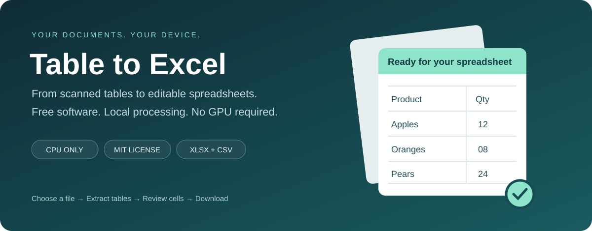
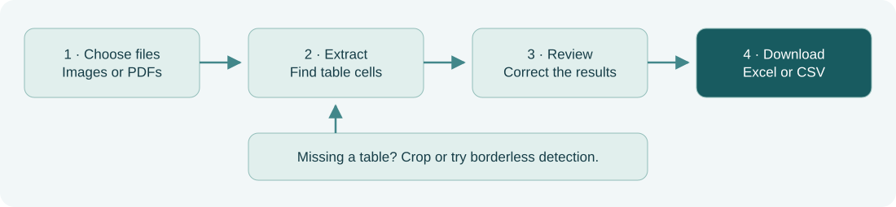
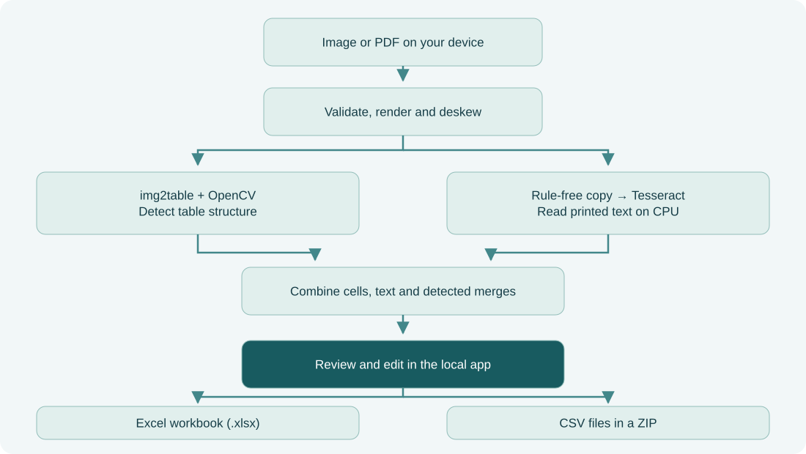
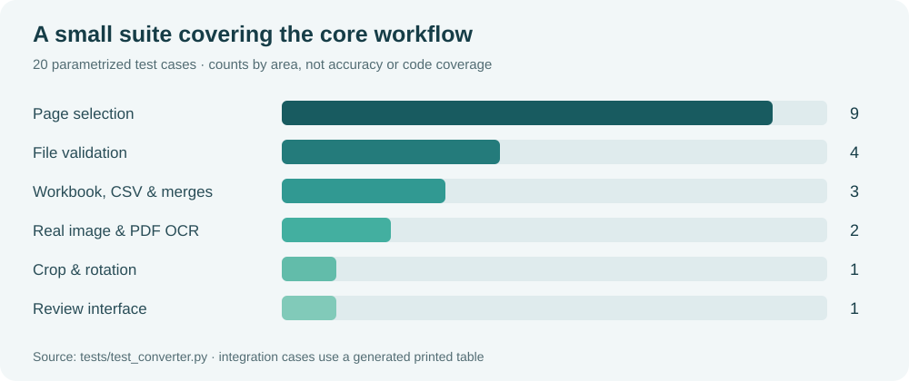

# Table to Excel

Turn scanned tables and PDFs into spreadsheets you can review, edit and export locally.


<sub>Actual OCR, correction and XLSX export; playback condensed. [Recording details](media/DEMO.md).</sub>

[](https://github.com/DylanMartinLSC/TableToExcel/releases/latest/download/TableToExcel-windows.zip)

Windows builds are unsigned: if SmartScreen appears, choose **More info → Run anyway**.

Extract the whole ZIP and run TableToExcel.exe. The portable build includes English Tesseract OCR and opens a local browser interface; keep its console open while working.

<div align="center">



[](https://github.com/DylanMartinLSC/TableToExcel/actions/workflows/tests.yml)
[](LICENSE)
[](pyproject.toml)


**Turn pictures and PDFs into spreadsheets you can review, edit, and keep.**

[Try the browser prototype](https://DylanMartinLSC.github.io/TableToExcel/web/) · [Install the local app](#quick-start) · [See how it works](#how-it-works) · [Report an issue](https://github.com/DylanMartinLSC/TableToExcel/issues)

</div>

---

Table to Excel is a free, open-source converter for printed tables in screenshots, scans, and PDFs. The local app runs on your CPU, shows editable extraction results, and exports an Excel workbook or CSV files. No account, subscription, GPU, or cloud OCR service is required.

> **Early release:** the core workflow is tested. Recognition quality depends on the document; always review numbers and identifiers. Broad accuracy benchmarks and parity with paid converters have not been established.

## At a glance

| Bring your document | Make it readable | Make it yours |
| :--- | :--- | :--- |
| Images and scanned/native PDFs | Automatic deskew and local OCR | Edit cells and add or delete rows |
| Multiple tables per page | Optional borderless detection | Rename worksheets or exclude tables |
| Batches of up to 20 files | Image rotation and crop preview | Download XLSX or a ZIP of CSV files |
| Choose specific PDF pages | Detect missing row/column dividers | Preserve detected merged cells |

## Choose how to use it

| | Local app | Browser prototype |
| :--- | :--- | :--- |
| Start here | [Installation below](#quick-start) | [Open the demo](https://DylanMartinLSC.github.io/TableToExcel/web/) |
| Runs on | Your computer, through a local browser interface | Your browser, using WebAssembly |
| Engine | img2table + native Tesseract | img2table in Pyodide + Tesseract.js |
| Review tools | Editable grid, row changes, worksheet names, exclusions | Table preview and Excel download |
| Input workflow | Batch uploads, crop/rotation controls | One file at a time |
| Network | Setup downloads; local conversion works offline | Downloads runtimes and OCR assets from external hosts |
| Status | Main implementation | Experimental; fewer controls and less validation |

Both implementations process document contents on the device. The hosted prototype loads third-party runtime scripts and assets; it is not a self-contained offline distribution. The local app is the recommended route for the complete review workflow.

## Quick start

### Windows

1. **Download the project:** use GitHub's **Code → Download ZIP**, then extract it to a normal folder.
2. **Install [uv](https://docs.astral.sh/uv/getting-started/installation/)**, which manages Python and the app's packages.
3. **Install [Tesseract OCR](https://tesseract-ocr.github.io/tessdoc/Installation.html)** with English language data. The app detects `C:\Program Files\Tesseract-OCR`; for a custom location, add Tesseract to `PATH`.
4. **Double-click `Start-Windows.bat`.** The first launch downloads dependencies. Your browser opens the local app; keep the launcher window open while you work.

To stop the app, close the launcher window. Future launches use the same file. Setup requires internet; conversion does not use a cloud service.

### Linux / macOS

Install [uv](https://docs.astral.sh/uv/getting-started/installation/) and Tesseract first:

```sh
# Ubuntu / Debian
sudo apt install tesseract-ocr

# macOS, with Homebrew
brew install tesseract
```

Then clone and start the project:

```sh
git clone https://github.com/DylanMartinLSC/TableToExcel.git
cd TableToExcel
uv sync --frozen --no-dev --python 3.12
uv run --no-sync streamlit run app.py --server.address 127.0.0.1 --browser.gatherUsageStats false
```

Open the local URL printed in the terminal, usually `http://127.0.0.1:8501`. Press **Ctrl+C** in the terminal to stop it.

## Your first conversion



1. Choose one or more files. For a large PDF, enter a page range such as `1, 3-5` in **Extraction options**.
2. Select **Extract tables**. A large scan can take several minutes.
3. Compare each result with its source. Correct cells, remove unwanted rows, rename sheets, and uncheck tables you do not need.
4. Download the combined **Excel workbook** or a **ZIP of CSV files**.

**Merged-cell tip:** Excel keeps only the top-left value of a merged region. Disable **Preserve detected merged cells** if you change row structure or need to edit covered cells individually.

## Supported files and exports

| Input | Supported | Notes |
| :--- | :---: | :--- |
| PNG, JPEG, BMP, WebP | Yes | Printed tables on a light background work best |
| TIFF | Single frame | Save pages separately or convert multi-frame TIFF to PDF |
| Native PDF | Yes | Existing text can be extracted directly |
| Scanned PDF | Yes | Uses local OCR |
| Password-protected PDF | No | Export an unprotected copy before conversion |
| Handwriting / irregular nested tables | Limited | Not reliably supported |

**Excel export:** one worksheet per selected table, optional merged cells, wrapped text, sized columns, and a frozen first row. Source fonts, colors, and exact page layout are not reconstructed.

**Values export as text.** This preserves identifiers such as `0012` and prevents OCR text from becoming executable Excel formulas. Calculations are not inferred. CSV values beginning with formula-like characters receive a leading apostrophe for safer opening in spreadsheet software.

## How it works



The local engine uses [img2table](https://github.com/xavctn/img2table) for table structure and [Tesseract](https://github.com/tesseract-ocr/tesseract) for OCR. Long rules are removed from a separate OCR copy so grid lines interfere less with text recognition; the structural image retains its lines. Processing runs sequentially to limit CPU pressure.

The browser prototype bridges synchronous Python extraction with asynchronous Tesseract.js OCR. PDF.js renders PDF pages, Pyodide runs the Python pipeline, and a worker handles extraction. See [`web/`](web/) for its implementation.

## Privacy and practical limits

The local launcher binds to `127.0.0.1` and disables Streamlit usage statistics. Files are processed locally; temporary OCR images are used during conversion. Uploaded data and results remain in the app session until cleared or the app closes. Downloaded files remain in your browser's download folder.

| Local app guardrail | Limit |
| :--- | ---: |
| Files per batch | 20 |
| Size per file | 30 MB |
| Image resolution | 40 megapixels |
| Pages per PDF | 50 |

This is a single-user local app. Do not expose its port to the public internet. There is no mid-extraction cancellation control; stop the app to abort a long run. The browser prototype has a different execution path; do not assume all local-app guardrails apply there.

## Troubleshooting

| What you see | What to try |
| :--- | :--- |
| “Install Tesseract OCR” | Install Tesseract, check its location or `PATH`, then restart the app |
| Missing language data | Install the matching Tesseract language pack and use a code such as `eng`, `fra`, `deu`, or `eng+fra` |
| No tables found | Crop around one table, try borderless detection, or use a sharper scan |
| Faint or missing words | Lower the minimum confidence filter; review added text carefully |
| Borderless table is missed | Use at least three rows with consistent alignment; some layouts will still fail |
| Large file is rejected | Split the PDF or resize the image within the limits above |
| Incorrect merged output | Turn off merged-cell preservation, especially after adding or deleting rows |
| Slow first conversion | Allow initialization to finish; try a smaller page range for large documents |

## Tests and quality



The suite checks page-range parsing, malformed files, crop/rotation behavior, workbook reopening, duplicate sheet names, merge handling, leading zeros, formula-safe export, and rendering of the review interface. Two integration cases run real CPU OCR on a generated printed table: one image and one scanned PDF.

The chart counts parametrized test cases. It is **not a code coverage percentage, document accuracy score, or performance benchmark**. The desktop tests do not establish browser-prototype compatibility. GitHub Actions runs the Python suite and lint checks on Ubuntu; the workflow badge above shows its current status.

```sh
uv sync --frozen --python 3.12
uv run pytest -q
uv run ruff check .
```

Tesseract and English language data are required for integration tests. Exact Python package versions are recorded in [`uv.lock`](uv.lock).

## Project map

```text
TableToExcel/
├── app.py                   Local review interface
├── converter.py             Validation, CPU OCR, table conversion, safe export
├── Start-Windows.bat        Windows launcher
├── tests/test_converter.py  Unit, integration, and app tests
├── web/                     Experimental browser implementation
├── docs/assets/             README visuals
└── .github/workflows/       Python checks and GitHub Pages deployment
```

## Roadmap and contributions

Areas that need more work before a stable public release:

- [ ] Benchmark varied real-world, multilingual, borderless, and merged-cell documents.
- [ ] Package native installers and simplify language-pack setup.
- [ ] Add browser compatibility and end-to-end conversion tests.
- [ ] Improve correction tools and cancellation for long jobs.
- [ ] Evaluate alternative OCR/layout engines for complex documents.

[Open an issue](https://github.com/DylanMartinLSC/TableToExcel/issues) with a **synthetic or redacted sample**, the expected table, your OS, and Tesseract version. Do not submit private documents. Before submitting a pull request, run the tests and lint checks above. Report sensitive security issues privately to the maintainer rather than attaching private files to a public issue.

## License and acknowledgments

[MIT licensed](LICENSE). You can use, modify, and redistribute this project's code under that license. Dependencies retain their own licenses and notices.

Built with [img2table](https://github.com/xavctn/img2table), [Tesseract](https://github.com/tesseract-ocr/tesseract), [OpenCV](https://github.com/opencv/opencv), [Streamlit](https://github.com/streamlit/streamlit), [openpyxl](https://openpyxl.readthedocs.io/), [Pillow](https://github.com/python-pillow/Pillow), and [pypdfium2](https://github.com/pypdfium2-team/pypdfium2). The browser prototype also uses [Pyodide](https://github.com/pyodide/pyodide), [Tesseract.js](https://github.com/naptha/tesseract.js), and [PDF.js](https://github.com/mozilla/pdf.js).
